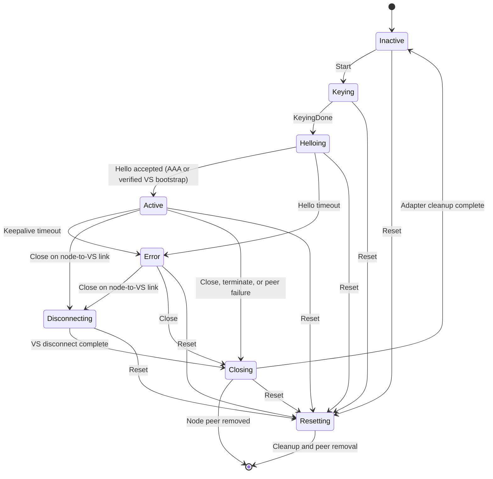
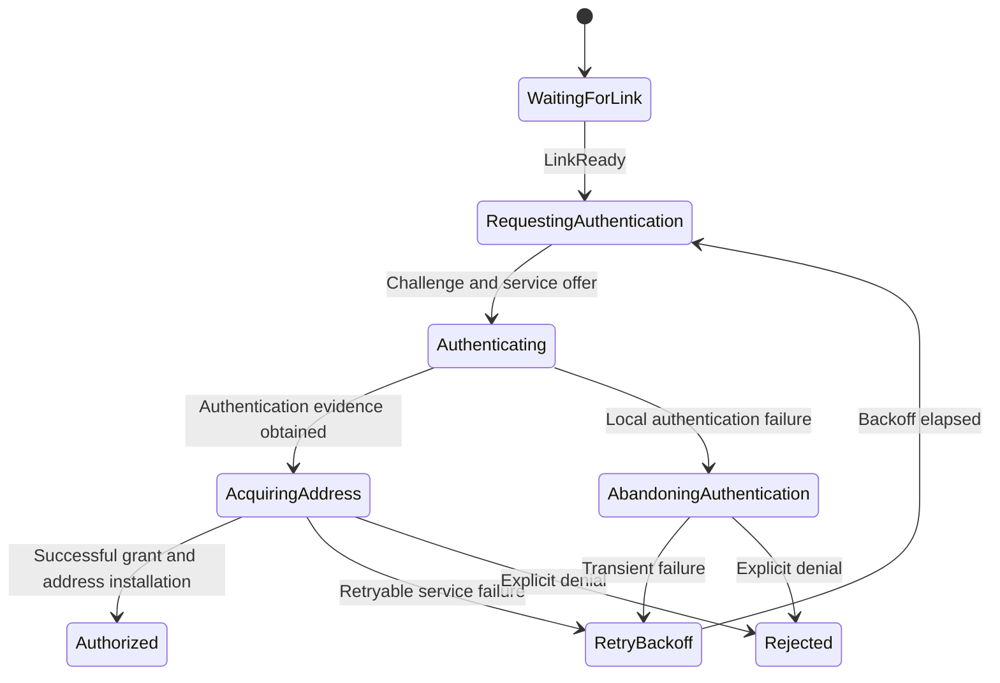
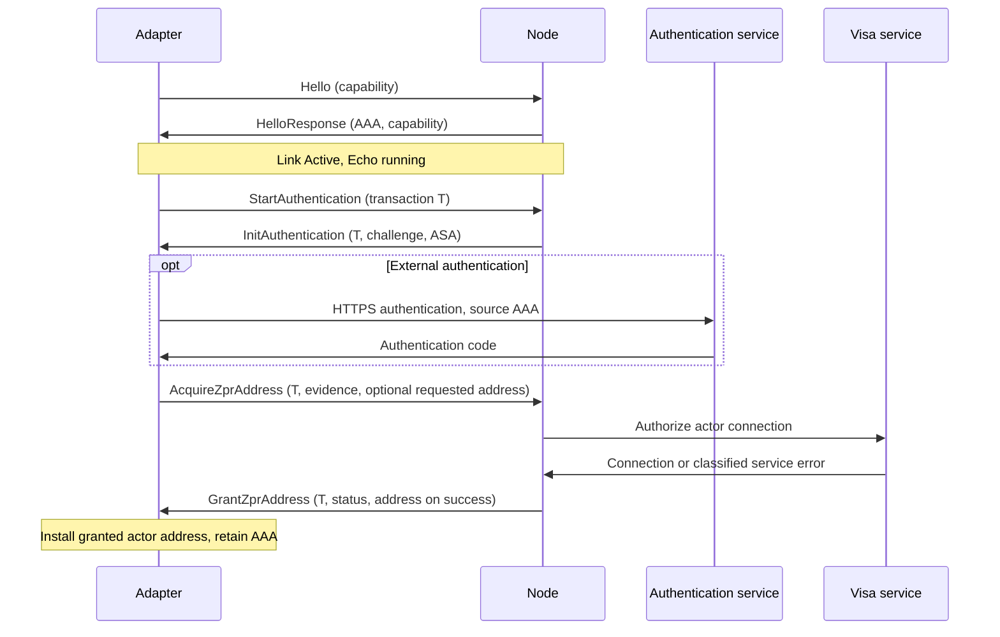

# Actor authorization

An encrypted adapter-node link becomes **Active** after keying and Hello, before
actor authorization. Hello configures an adapter authentication address (AAA) on
the adapter TUN and enables carrier. Echo keepalives run from this point, including
while actor authorization is pending or rejected. Carrier is link readiness, not
actor readiness; `ph-cli link show 2` reports the independent actor state.

Each adapter still supports exactly one actor. Requested/configured actor
addresses are not authorized addresses and are not installed at startup.
`ActorAuthorization` owns the authorization attempt and granted address separately
from `LinkStateWrapper`, which owns AAA, transport state, and keepalives.

## State machines

Close can be initiated from any running state; on a node-to-VS link with an
active VS connection it first enters `Disconnecting`, otherwise it enters
`Closing`. Reset enters `Resetting` from any state.

Ordinary links cannot establish without AAA. If the node has not received its AAA
pool from the visa service, Hello returns TemporarilyUnavailable and the adapter
retries link establishment. The only exception is an adapter whose verified
transport certificate identifies the visa service: its Hello response marks the
VS bootstrap exception. That link can establish without AAA and use bootstrap
authentication, but cannot perform external HTTPS authentication without AAA.

LinkDown from every actor state cancels local work, releases its transaction,
removes owned actor addresses and flow state, and returns to WaitingForLink.
Explicit rejection is latched for the adapter process, including across a link
reconnect; restarting the adapter is the current explicit retry mechanism.

External authentication uses HTTPS with AAA as its bound source address.
Credential/policy denials are terminal. Service failures and service timeouts
retry after exponential backoff starting at one second, with up to 249 ms jitter
and an overall 30-second cap. No timer treats a delayed ZDP result as a service
failure. After Acquire, the adapter waits for Grant or LinkDown.

AAA remains configured after grant. Newly installed AAA is a deprecated IPv6
source (still valid and explicitly bindable), so normal applications prefer
their granted actor address rather than accidentally sending actor traffic from
AAA. Externally configured addresses retain their existing source preferences.
Only the process's own TUN installations are
removed during teardown; externally managed addresses are preserved. Packet/bind
admission permits AAA and the granted actor address, not an ungranted configured
address. The existing visa policy controls AAA-to-authentication-service flows.

The node keeps a separate session per adapter: awaiting evidence, authorizing at
the visa service, then authorized or idle. It validates the offered bootstrap
challenge, not equality between actor identity and transport-certificate identity.
The visa service verifies actor evidence and assigns the actor address. A success
arriving after link teardown is deregistered rather than installed. VS bootstrap
retains deferred registration so the service can first become reachable through
its own adapter. Once VSAPI access is available, the node completes that deferred
registration **before** registering VSS: the VSS callback visa snapshots the
actors' A2A keys and must not be minted before the VS adapter key is registered.
This ordering does not repair a previously persisted callback visa with stale
key snapshots. Such visas must be replaced/reminted by the VS, or testing must
use fresh VS state; repeating VSS registration can reuse the existing visa.

## Coordinated-upgrade wire protocol

These are repository-local **experimental assignments**, not registered protocol
numbers. Both peers must be upgraded together; no legacy authorization path is
provided.

Hello request and response carry TLV 9, `ACTOR_AUTH_PROTOCOL`, with a two-byte
big-endian version of 1. Missing, duplicate, malformed, or unsupported capability
is rejected. Hello response TLV 10, `VS_BOOTSTRAP_LINK`, has the two-byte value 1
only for the verified VS adapter. Hello statuses are Success (0), Other (1),
UnsupportedProtocol (2), and TemporarilyUnavailable (3).

All authentication messages are non-flow management messages:

`ZDP base header | management header | transaction ID (u16, big-endian) | body`

| Message | Type | Body |
| --- | --- | --- |
| StartAuthentication | 142 | Empty |
| InitAuthentication | 141 | Status (u8), flags (u8), challenge length (u16), challenge, ASA TLVs |
| AcquireZprAddress | 138 | Blob length (u16), IP version (u8), address count (u8), blob, requested address |
| GrantZprAddress | 139 | Status (u8), IP version (u8), address count (u8), granted address |
| AbandonAuthenticationAttempt | 143 | Empty |

Authentication statuses are Success (0), Rejected (1), and Retryable (2).
Init's existing bootstrap flag and challenge format are retained. An unsuccessful
Init has no challenge. Acquire requires evidence and zero or one requested
address. A successful Grant has exactly one address; unsuccessful grants have
none. Unknown statuses, extra addresses, truncated bodies, and trailing bytes
are invalid.

The adapter reserves one handle from the link's existing `mgmt::txn_mgr`, sharing
the u16 namespace with bind/stream transactions. The handle spans the entire
Start/Init/authentication/Acquire/Grant exchange. The node echoes the raw ID
without allocating a handle. On local failure before Acquire, the adapter sends
Abandon after receiving Init, waits for ZDPR acknowledgement, then releases the
handle. Serial node management processing handles abandonment before a subsequent
Start. The ACK means queue admission, **not remote action completion**; there is
no Abandon response.

ZDPR and Echo own exactly-once delivery and forward progress or link termination.
There are no actor-layer retransmissions, deduplication caches, status polling,
response replay, or completion confirmations. Link-local generation guards reject
stale asynchronous service completions; they are not additional wire IDs.

Multiple actors per adapter, authorization renewal/expiry enforcement, and
revocation remain follow-on work. In particular, this change does not implement
RevokeZprAddress or the existing VSS RevokeAuth stub.
